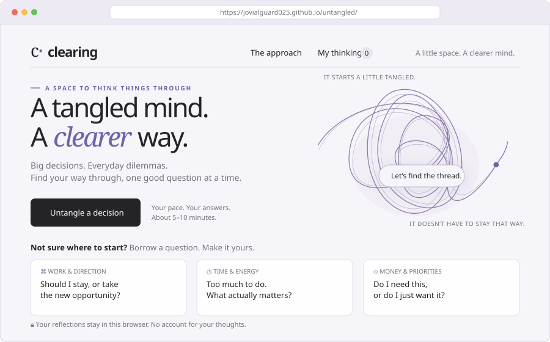

<p align="center">
  
</p>

<h1 align="center">untangled</h1>

<p align="center">
  <strong>A tangled mind. A <em>clearer</em> way.</strong><br>
  Untangle everyday decisions — one good question at a time.
</p>

<p align="center">
  <a href="#-quick-start"></a>
  <a href="#-features"></a>
  <a href="LICENSE"></a>
  <a href="#-privacy"></a>
</p>

<p align="center">
  <a href="https://jovialguard025.github.io/untangled/">🌐 Live Demo</a> ·
  <a href="docs/EXPLAINED_SIMPLY.md">💡 Explained Simply</a> ·
  <a href="docs/reading_plan/MASTER_INDEX_100_PAPERS.md">📚 100 Research Papers</a> ·
  <a href="docs/reading_plan/CHECKPOINT_50_REVIEW.md">🏁 Checkpoint 50</a> ·
  <a href="docs/MATHEMATICAL_MODEL.md">📐 Math Blueprint</a> ·
  <a href="CONTRIBUTING.md">🤝 Contribute</a>
</p>

---

## ✨ What is Untangled?

**Untangled** is a structured reflection tool for decision-making. It doesn't tell you what to do — it helps you think clearly about what *you* want to do.

Whether you're facing a career crossroads, a spending dilemma, or just too many things competing for your time, Untangled walks you through six stages of guided questioning to help you:

- 🎯 **Name** the actual decision (not just the feeling)
- 🧱 **Set boundaries** — hard limits vs. flexible preferences
- 🔀 **Find options** beyond the obvious binary
- 🔍 **Question assumptions** you're treating as facts
- ⚖️ **Weigh trade-offs** with simple, honest scoring
- 🚶 **Move forward** with one small, revisable step

> *"My life is stressful" is a feeling.*
> *"Which commitment can I reduce this week?" is a decision you can work with.*

<p align="center">
  
</p>

---

## 💡 Why Not Just Ask a Chatbot? (In Plain English)

When faced with a tough dilemma, many people ask ChatGPT or Claude: *"Should I quit my job?"* or *"Should I buy this house?"*

Recent studies (auditing over 17,000 conversations) discovered something surprising: **people who use chatbots to make personal choices end up *more doubtful and less confident* than people who just write their thoughts in a journal.**

Here is why normal chatbots fail, and what **Untangled** does instead:

| The Problem with Chatbots 🤖 | How Untangled Solves It 🧶 |
| :--- | :--- |
| **They flatter you ("Yes-Men"):** Chatbots agree with whatever mood you're in. If you want to make an impulsive purchase, they tell you why it's great. | **A thinking mirror:** Untangled never gives advice. It asks the tough questions so you can hear yourself think clearly. |
| **They rush you:** Chatbots pressure you into picking quickly whenever you pause or hesitate. | **Your own pace:** Self-paced visual steps with no countdown, no pressure, and total calm. |
| **They forget hard limits:** A chatbot might suggest an option that costs more than you have or demands hours you don't have. | **Hard limits are locked:** If an option breaks your non-negotiable rule (money, health, family), the app **disables it**. |
| **They don't face the consequences:** If an AI gives bad advice, it doesn't suffer. **You do.** | **You stay 100% in charge:** You make the choices; the tool only makes the trade-offs visible. |

👉 *Want to read the full guide in everyday terms? Check out [docs/EXPLAINED_SIMPLY.md](docs/EXPLAINED_SIMPLY.md).*

---

## 🚀 Quick Start

**No build step. No npm install. No API keys. No database.**

```bash
# Clone it
git clone https://github.com/jovialguard025/untangled.git
cd untangled

# Serve it (pick one)
node serve.js
# or
python -m http.server 8000 --directory dist
# or
npx serve dist
# or just open dist/index.html in your browser
```

Then visit **http://localhost:8000** and untangle something.

> **Note:** Google Fonts (DM Sans & Manrope) require an internet connection; system fonts serve as fallbacks. Use a local server instead of `file://` for consistent `localStorage` behavior.

---

## 📖 The Six Stages

Untangled guides you through a complete reflection in about **5–10 minutes**:

```
┌─────────────┐    ┌────────────────┐    ┌──────────────┐
│  1. Name It │───▶│ 2. Set Limits  │───▶│ 3. Find Ways │
└─────────────┘    └────────────────┘    └──────────────┘
                                                │
┌──────────────┐   ┌────────────────┐    ┌──────▼───────┐
│ 6. Move Fwd  │◀──│ 5. Weigh It Up │◀───│ 4. Question  │
└──────────────┘   └────────────────┘    └──────────────┘
                           │
                    ┌──────▼───────┐
                    │  ✨ Summary  │
                    └──────────────┘
```

| Stage | What You Do | Why It Matters |
|-------|-------------|----------------|
| **Name it** | Turn a vague feeling into a specific, workable decision | You can't solve "I'm overwhelmed" — but you can solve "What do I drop this week?" |
| **Set boundaries** | Identify hard limits (non-negotiable) and soft constraints (flexible) | Knowing your real constraints prevents fantasy planning |
| **Find options** | Write 2–3 genuinely different paths, including "do nothing" | Breaking the false binary opens creative solutions |
| **Question it** | Separate verified facts from assumptions and predictions | You notice where you're guessing and where you actually know |
| **Weigh it up** | Score each option on goal fit, feasibility, and priority alignment (1–5) | Makes invisible trade-offs explicit and comparable |
| **Move forward** | Choose a direction, define one small action, set a review date | Turns analysis into a concrete, revisable commitment |

### Scoring System

Each option is rated on three equally-weighted dimensions:

| Dimension | Question |
|-----------|----------|
| **Goal Fit** | How well does this serve what I actually want? |
| **Practicality** | Can I actually do this within my constraints? |
| **Priority Fit** | Does this align with what matters most to me? |

- Scores range from **3** (all 1s) to **15** (all 5s)
- Options flagged as violating hard limits are **disabled** in the final selection
- Scores are prompts for thinking — not algorithmic verdicts

---

## 🏗️ Architecture

```
untangled/
├── dist/                   # Production-ready static site
│   ├── index.html          # Page shell, navigation, dialog
│   ├── style.css           # Complete stylesheet (lavender/ink palette)
│   └── app.js              # All application logic
├── docs/                   # Documentation & research assets
│   ├── banner.svg          # Repository banner
│   ├── preview.svg         # High-fidelity SVG UI preview
│   ├── EXPLAINED_SIMPLY.md # Plain-English explanation for everyday people
│   ├── reading_plan/       # 100-paper literature syllabus in 10 everyday packets
│   │   ├── MASTER_INDEX_100_PAPERS.md # Master syllabus & tracking matrix
│   │   ├── CHECKPOINT_50_REVIEW.md    # Midpoint synthesis of Papers 1–50
│   │   ├── packet_01_mcda_foundations.md
│   │   └── ... (Packets 02 through 10)
│   ├── RESEARCH.md         # Empirical research & ACL/arXiv literature analysis
│   ├── MATHEMATICAL_MODEL.md # Math formulations (AHP, CPT, Active Inference)
│   └── DESIGN.md           # Design philosophy & decisions
├── .openai/
│   └── hosting.json        # Original hosting config (optional)
├── CONTRIBUTING.md          # Contribution guidelines
├── LICENSE                  # MIT License
└── README.md                # You are here
```

### Tech Stack

| Layer | Technology |
|-------|-----------|
| **Markup** | Semantic HTML5 |
| **Styling** | Vanilla CSS with custom properties, responsive breakpoints, print styles, reduced-motion support |
| **Logic** | Vanilla JavaScript (ES6+), no framework, no bundler |
| **Typography** | Google Fonts: DM Sans (body), Manrope (headings), Georgia (accents) |
| **Illustration** | Inline SVG (the tangled thread) |
| **Persistence** | `localStorage` (`clearing-records` key) |
| **Deployment** | Any static file server, GitHub Pages, or just open the HTML |

### Zero Dependencies

- ❌ No npm packages
- ❌ No build tools or bundlers
- ❌ No frameworks or libraries
- ❌ No API keys or server routes
- ❌ No database or analytics
- ❌ No AI/LLM integration

---

## 🔒 Privacy

Your reflections **never leave your browser**.

- All data is stored in `localStorage` under the key `clearing-records`
- No data is transmitted to any server
- No cookies, no tracking, no analytics
- No account creation required
- On shared devices, delete your reflections when finished
- Clearing browser data will remove saved reflections

---

## 🎨 Design

### Color Palette

| Token | Hex | Usage |
|-------|-----|-------|
| `--bg` | `#f6f5f9` | Page background |
| `--ink` | `#242428` | Primary text, buttons |
| `--muted` | `#74727b` | Secondary text |
| `--line` | `#dedce5` | Borders, dividers |
| `--purple` | `#7161aa` | Accent, interactive elements |
| `--lav` | `#e8e3f3` | Highlight backgrounds |

### Accessibility

- Semantic HTML with ARIA labels and roles
- Focus-visible outlines on all interactive elements
- `prefers-reduced-motion` media query disables all animations
- Print stylesheet hides chrome, shows content
- Color contrast meets WCAG guidelines

### Responsive

- Desktop-first layout with mobile breakpoint at `760px`
- Progress steps collapse to a horizontal bar on mobile
- Typography scales with `clamp()` for fluid headings

---

## 🧪 Testing

The project includes no automated test suite (it's a single-page vanilla app), but here's how to verify it works:

```bash
# 1. Syntax check
node --check dist/app.js

# 2. Serve locally
python -m http.server 8000 --directory dist

# 3. Manual walkthrough
# - Visit http://localhost:8000
# - Click "Untangle a decision" or pick a starter
# - Complete all 6 stages with sample data
# - Verify the summary shows your scores correctly
# - Flag an option as violating hard limits
# - Confirm it's disabled in the final selection dropdown
# - Save, close, reopen — verify persistence
# - Click "My thinking" — verify saved reflections appear
# - Delete a reflection — verify it's removed
# - Print / save as PDF — verify clean output
```

### SHA256 Verification

```bash
# Verify byte-for-byte integrity of source files
sha256sum -c SHA256SUMS.txt
```

---

## 📄 License

[MIT](LICENSE) — Mathew Albin

---

## 🙏 Credits

**Designed & built by [Mathew Albin](https://github.com/jovialguard025)**

A quiet tool for the beautifully complicated business of being human.

*Less noise. More perspective.*
